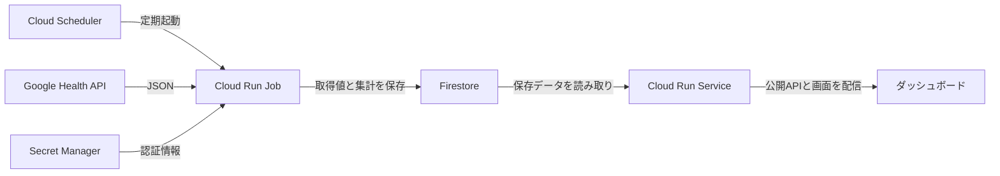

# Fitbit Air 公開APIとダッシュボードの実装プラン

Google Health APIから本人のFitbit Airのデータを定期取得し、Firestoreに90日分を保存する。公開APIとダッシュボードで期間を指定し、心拍・睡眠・活動・生体指標を振り返れるようにする。心拍は1分ごとの平均・最小・最大を保存し、1時間分を1ドキュメントにまとめる。

既存のGoogle Cloudプロジェクトを利用し、無料枠に収まる運用を目指す。初版は本人1人のデータを扱い、閲覧用のログインは設けない。本人のGoogleアカウントとの接続はローカルの管理コマンドから行う。仕様の基準日は2026年10月11日。

**1. 初版の機能と表示仕様**

| 項目 | 実装する内容 |
| --- | --- |
| 心拍 | 1分ごとの平均・最小・最大、日別の安静時心拍数 |
| 睡眠 | 開始・終了時刻、睡眠時間、睡眠段階、覚醒。日付をまたぐ睡眠と昼寝にも対応 |
| 活動 | 歩数、距離、消費カロリー、アクティブゾーン時間 |
| 生体指標 | HRV、SpO₂、呼吸数、皮膚温変化の日別データ。取得できた値と対象日を明示 |
| 表示期間 | 直近24時間・7日・30日・90日、保存範囲内の任意期間、前後の期間への移動 |
| 時刻 | 保存・APIの時刻はUTC、画面はAsia/Tokyo。日別の睡眠は起床日に対応付ける |
| 欠損 | 未取得・未装着などを0として扱わず、グラフの欠損や未取得表示にする |
| 更新表示 | 同期成功時刻と、各指標でデータがある最新日時を分けて表示 |
| 振り返り | 選択期間をURLに保存できる。同期が遅れても保存済みのグラフを表示 |

心拍の表示粒度は24時間で1分、7日で5分、30日で1時間、90日で1日を標準とする。平均の線に最小・最大の帯を重ねる。生体指標は日別、睡眠は短期間で段階のタイムライン、長期間で日別の時間と段階内訳を表示する。

睡眠の1日の内訳は各セッションを日付順に開いて確認できる。期間との重なりで検索し、日付をまたぐセッションを取りこぼさない。途中の期間を選択した場合も、睡眠詳細では実際の開始・終了時刻を表示する。

今日の活動や生体指標は、集計途中・対象日・未取得状態を区別する。皮膚温は基準からの変化量として表示する。初版に体調メモ、秒単位の心拍表示、睡眠スコアや準備スコアは含めない。

**2. 採用する構成**

| 部分 | 技術・配置 | 役割 |
| --- | --- | --- |
| ダッシュボード | React、TypeScript、Vite、Apache ECharts | 期間選択、グラフ、睡眠詳細、同期状態の表示 |
| 公開API | Node.js 24 LTS、TypeScript、Fastify、Cloud Run Service | Firestoreからデータを読み、表示向けJSONを返す。ビルド済みフロントエンドも配信 |
| 取得・集計 | TypeScript、Cloud Run Job | Google Health APIの取得、正規化、保存、表示用集計、期限超過データの削除 |
| 定期実行 | Cloud Scheduler | 原則15分ごとに同期ジョブを起動 |
| 保存 | Firestore Standard、Native modeの既定データベース | 時系列、日別値、睡眠セッション、同期状態を保存 |
| 認証情報 | Secret Manager | OAuthクライアント情報とrefresh tokenの保存 |
| 開発・検証 | npm workspaces、Vitest、Firestore Emulator、Playwright | 共有型、集計・保存処理・API・主要画面操作の検証 |



Cloud Run ServiceとJobは同じコードベースから作り、実行コマンドとサービスアカウントを分ける。閲覧のたびにGoogle Health APIを呼ばず、公開APIはFirestoreを読む。ブラウザからFirestoreへ直接アクセスする構成にはしない。

新規に配置する場合の既定リージョンは、日本からの利用を想定して東京（asia-northeast1）とする。既存Firestoreのモード・リージョン・他用途での利用を確認し、適合する既定DBがあれば再利用する。APIと同期処理もDBと同じリージョンに置く。依存ライブラリは実装開始時に互換性を確認し、lockfileで固定する。[Node.jsのリリース情報](https://nodejs.org/en/about/previous-releases)

EChartsは使うグラフと機能を選んで読み込む。[EChartsのモジュール読み込み](https://echarts.apache.org/handbook/en/basics/import/)

**3. 最初に確かめる外部条件**

Google Health APIを有効にした既存プロジェクトで、本人のOAuth同意から実データ取得までを先に検証する。この段階で取得可能な指標・権限・データ源を確定し、その結果を保存処理と画面に反映する。

- プロジェクトID、課金設定、既定Firestoreの有無・モード・リージョンを確認する。
- ローカルの接続コマンドに、登録したlocalhost redirect URI、OAuth stateの検証、offline accessを実装する。
- activity_and_fitness、health_metrics_and_measurements、sleepの読み取りスコープを対象にし、各指標の必要権限と実際の許可を確認する。
- OAuth完了後にgetIdentityでGoogle Healthとの連携を確認し、心拍・睡眠・活動・日別生体指標を少量取得する。
- リクエストと返却形式、単位、日別データの日付、ページング、欠損時の返り方を確認する。テスト用に残すデータは架空値に置き換える。
- Fitbitアプリの同期後にデータが届く時間差を確認する。15分ごとの取得を、15分以内に測定値が更新される保証として扱わない。
- OAuth同意画面の公開状態とトークン期限を確認し、継続同期できる設定と再接続手順を確定する。

本人が不在でも同期するためにoffline accessを利用する。ExternalかつTesting状態のOAuth設定では、対象のrefresh tokenは原則7日で期限が切れる。運用設定の確認を初期接続の完了条件に含める。[offline accessの仕様](https://developers.google.com/identity/protocols/oauth2/web-server#offline)、[refresh tokenの期限](https://developers.google.com/identity/protocols/oauth2#expiration)

データ源には原則users/me/dataSourceFamilies/google-wearablesを指定する。この指定にはFitbit以外のGoogleウェアラブルも含まれるため、Airだけを指定したものとして扱わない。本人のアカウントに別の記録機器がある場合は、Air由来の分離可否を実データとフィルター仕様で確認して取得方針を決める。[アカウント連携とデータ源の仕様](https://developers.google.com/health/endpoints)

**4. Firestoreの保存構造**

初版は単一所有者用のコレクションを使い、時刻から決まるIDで繰り返し更新できるようにする。各ドキュメントにはschemaVersionと内容の更新日時を持たせる。

| コレクション | 保存単位 | 主な内容 |
| --- | --- | --- |
| seriesHourly | 指標とUTCの1時間 | 最大60個の1分値。心拍はavg・min・max、活動は指標に応じた合計値 |
| dailyMetrics | 対象日 | 安静時心拍、HRV、SpO₂、呼吸数、皮膚温変化、対象日・単位・取得状態 |
| sleepSessions | セッション | 元の開始・終了時刻、睡眠段階、覚醒、日別の対応付け |
| displayRollups | 指標・解像度・日 | 5分・1時間・1日の表示用集計。短いレスポンスで長期間を表示 |
| syncState | 指標ごとの状態 | 試行・成功時刻、取得済み範囲、バックフィル位置、再取得位置 |
| jobLease | 同期ジョブの実行状態 | 重複実行を防ぐ期限付きのロック |

心拍の1時間ドキュメントは、hourStartと、各分のavg・min・maxを含むpointsを持つ。取得できない分はnullで表現する。1時間にまとめても、1分値は保持する。活動のポイントには心拍用の平均・最小・最大を無理に付けず、指標の合計値と単位を保存する。

日別の生体指標はGoogle Health APIの日別データを優先し、返される値の意味を保つ。日付・対象期間・取得日時を別々に持たせる。睡眠の段階と短い覚醒が重なる場合は、時間の二重計上を避けて正規化する。[データ型と日別値の仕様](https://developers.google.com/health/data-types)、[睡眠データの仕様](https://developers.google.com/health/data-types/sleep)

活動の明示的な0とレコードそのものの欠損を区別する。上流のJSONでは既定の0のフィールドが省略される場合があるため、レコード・値の存在を確認して正規化する。[欠損と0の仕様](https://developers.google.com/health/data-presence-and-true-zeros)

pointsや睡眠段階配列はインデックス対象から外し、日時など検索に必要な項目だけを対象とする。ドキュメントのサイズ上限も保存前に確認する。[Firestoreのインデックス方針](https://firebase.google.com/docs/firestore/best-practices)、[Firestoreの上限](https://firebase.google.com/docs/firestore/quotas)

**5. 同期・訂正・90日保存の処理**

| 処理 | 実行方法 |
| --- | --- |
| 初期取り込み | 過去90日を最大7日ずつ分割し、全ページを取得。指標と区間ごとの進捗を保存し、途中から再開できる |
| 通常同期 | 15分ごとに直近48時間を重ねて取得。日別指標は対応する日付と直近の数日を再確認する |
| 古い値の再確認 | 週1回、開始時点の過去90日を最大7日ずつ再取得。取得位置を保存し、未完了分は次のジョブで続ける |
| 表示用の集計 | 内容が変わった時間・日だけを作り直す |
| 期限超過分の削除 | 同期ジョブ内で測定時刻・対象期間を基準に削除する。境界の時間ドキュメントからも期限超過ポイントを除く |
| 手動操作 | backfill、sync、repair、pruneの管理コマンドを用意する |

初版の48時間の再取得幅は、データの到着遅延と処理時間を実測して調整する。未取得期間が48時間を超えた場合は、直前の成功位置から必要な範囲を取り直す。再確認も途中から再開できるようにする。

心拍はrollUpにwindowSize: 60sを指定して取得する。心拍のrollUpには1回の範囲が最大14日という制限があるため、90日を1リクエストにはしない。各リクエストでnextPageTokenがなくなるまで同じ条件で取得する。[rollUpの仕様](https://developers.google.com/health/reference/rest/v4/users.dataTypes.dataPoints/rollUp)

心拍と活動はrollUpで取得し、睡眠・日別指標は対応するreconcileを優先する。サーバー側で重複を解消した返却値を使い、同じ測定を足し合わせない。[同期とreconcileの仕様](https://developers.google.com/health/data-management)

保存前に内容を比較して、変化したドキュメントだけを書き込む。全ページの取得に成功した区間だけを置換・削除対象にする。途中のページ取得失敗や認証失敗を、データなしとして保存しない。再取得に成功した範囲で点やセッションが消えた場合は、保存側と表示用集計にも反映する。

HTTP 429・一時的な5xxは待ち時間を増やしながら有限回リトライし、Retry-Afterを尊重する。指標ごとに成功・失敗を記録し、一部失敗でも他の指標の取得を進める。期限付きロックで重複実行を防ぐ。認証の再接続が必要な場合は保存済みデータの配信を続け、同期状態に反映する。

APIはリクエスト時点の90日範囲を守る。保存側の期限超過分は次の同期で削除し、ジョブ停止時でも期限外データを公開APIから返さない。睡眠セッションは終了時刻、日別値は測定対象日の期間を基準に扱う。TTL自動削除は無料枠対象外のため、初版では既存ジョブで削除する。[Firestoreの料金とTTL](https://cloud.google.com/firestore/pricing)

**6. 集計の意味とAPI契約**

長期間の心拍のavgは、取得できた1分平均値の算術平均と定義する。minは1分最小値の最小、maxは1分最大値の最大とする。全区間が欠損なら各値をnullにする。

Google Health APIの心拍rollUpには元サンプル数が含まれないため、このavgを元の秒単位測定値すべての厳密な平均として扱わない。APIに集計方法と取得できた1分区間数を含め、画面では「1分値から計算した平均」と説明する。[HeartRateRollupValueの仕様](https://developers.google.com/health/reference/rest/v4/HeartRateRollupValue)

階層化した集計ではavgだけを再平均せず、1分平均値の合計と有効な区間数を引き継ぐ。そうすることで、欠損の多い時間に不均等な重みを付けない。これは元センサーのサンプル数や実際の装着時間を示す数値ではない。

公開APIは次の4本を実装し、OpenAPI形式の契約を用意する。

| メソッドとパス | 用途 |
| --- | --- |
| GET /api/v1/summary | 選択期間の概要、日別値、各指標の更新状態 |
| GET /api/v1/timeseries | metric・from・to・resolutionで指定した時系列 |
| GET /api/v1/sleep | 指定期間と重なる睡眠セッションと段階 |
| GET /api/v1/status | 同期状態、最終成功時刻、指標ごとのデータ到達日時 |

- from・toはRFC 3339の分境界の時刻とし、開始を含み終了を含まない範囲を指定する。
- 日別の区間はAsia/Tokyo、5分・1時間の区間はUTCの境界に合わせる。端数区間は1分値から集計する。
- 心拍と活動のresolutionはauto・1m・5m・1h・1d。autoは表示期間に応じて選択する。日別の生体指標は1dとして返す。
- timeseriesの1レスポンスは最大4,096区間とする。多すぎる粒度、保存期間外、不正な指標・時刻は400とし、適切な粒度や保存範囲を返す。
- sleepは最大50セッションずつ返し、続きがあればcursorを返す。画面は選択期間の全ページを取得する。
- レスポンスには単位、from・to、実際の解像度、集計方法、syncedAt、dataThrough、取得できた区間数を含める。
- 初期取り込み前や本当にデータがない範囲は空データと状態を返す。DBの読み取り失敗は503とし、欠損に置き換えない。
- summaryは選択期間の統計と「最新の測定」を区別し、最新値には対象日時を必ず付ける。

活動は区間内の合計、日別の生体指標は対象日の値、睡眠はセッションと段階として返す。異なる単位を同じ縦軸に重ねない。

**7. ダッシュボードと配信**

画面の上部に期間選択と同期状態、続いて概要、心拍、活動、睡眠、生体指標の順でグラフを置く。スマートフォンでは縦方向に並べ、デスクトップでは概要と日別指標を見やすい幅に配置する。

- 期間のプリセット、任意日時、前後の期間移動を同じ操作群にまとめる。
- URLには確定したfrom・toを保存する。「直近」は開いた時点の範囲に変換し、保存したURLは同じ日時を再表示する。
- 心拍・活動の時間軸とカーソルを連動させ、睡眠との前後関係を見られるようにする。
- 睡眠を選択するとセッションの開始・終了と段階を開く。長期間では日別グラフから詳細へ進める。
- グラフの点を結んで欠損を隠さず、読み込み中・初期取り込み中・空データ・取得エラー・同期遅延を区別する。
- 色だけに依存しない凡例とラベルを付け、キーボードで期間選択と睡眠詳細を操作できるようにする。
- 開発用の架空データは開発モードだけで使い、公開環境の未取得時に混ぜない。

API応答には短いHTTPキャッシュとETagを付ける。初期値は60秒とし、端末側の重複取得とサーバー内の同一条件の読み取りを抑える。サーバー内キャッシュは件数を制限し、更新日時に応じて再取得する。複数インスタンスの共有キャッシュは初版では設けず、実測した読み取り回数に基づき調整する。

保存期限にかかる応答は期限を超えてキャッシュしない。サーバー内キャッシュを使う場合も、公開範囲をリクエスト時点で再確認する。

API・静的ファイルを同じCloud Run Serviceから配信し、外部ロードバランサーは初版に追加しない。静的ファイルはファイル名のハッシュとキャッシュを使い、APIレスポンスは圧縮する。

**8. 権限と無料枠に向けた設定**

公開API用サービスアカウントはFirestoreの読み取り、同期用はFirestoreの更新と指定したSecretの読み取り、Scheduler用はジョブの起動に必要な権限を持つ。本人のOAuth連携操作とジョブの起動は閲覧用APIから実行できないようにする。Firestoreのクライアント向けルールは直接アクセスを許可せず、サーバーはIAMで接続する。

Google Healthのトークン、GoogleアカウントID、デバイス識別子、上流APIの詳細エラーを公開レスポンスに含めない。認証情報と測定値の本文をログへ出さず、指標・対象範囲・取得件数・変更件数・処理時間・エラー種別を記録する。

無料枠を目指す初期設定は、Cloud Run Serviceの最小インスタンス0、最大インスタンス2、リクエスト課金とする。Jobは1タスク、1 vCPU、512 MiBを開始点とし、実測で調整する。既定Firestoreの無料枠には他の用途の消費分も含めて考える。

心拍を1時間単位で保存した場合は90日で約2,160ドキュメントになる。毎回現在の1時間だけが変わる単純モデルでは書き込みは1日96件だが、実際には訂正・活動・生体指標・睡眠・集計・同期状態の更新が加わる。導入時に1日あたりの全指標の読み書き回数、保存容量、配信量を実測して無料枠と比較する。

Cloud Run Jobには実行1回あたり最低1分の課金時間がある。30日、15分間隔、1 vCPU、毎回1分以内に終了する場合は172,800 vCPU秒となる。長い再取得やリトライ、他の用途の使用量、配信・ビルド・コンテナ保存は別に評価する。[Cloud Runの料金](https://cloud.google.com/run/pricing)

**9. 実装順序と各段階の完了条件**

| 段階 | 作業 | 完了条件 |
| --- | --- | --- |
| 1 接続とデータ確認 | ローカルOAuth接続コマンド、少量取得、スコープ・データ源・日別値の確認 | 本人のアカウントで取得とトークン更新ができる。各指標の取得可否と保存への対応が決まる |
| 2 プロジェクト基盤 | npm workspaces、型・日時・指標定義、API契約、架空データ、検証環境 | 各アプリが起動・ビルドでき、同じ型と時刻・欠損の定義を使える |
| 3 心拍の取得と保存 | 1分rollUp、全ページ取得、1時間保存、進捗・期限削除、集計 | 90日取り込みを再開でき、同じ取得を繰り返しても重複しない。訂正・削除・欠損が反映される |
| 4 他指標の保存 | 睡眠・活動・日別生体指標、指標別の同期状態 | 初版の全指標を扱い、日跨ぎ・未取得・部分失敗が正しく保存される |
| 5 公開API | 4エンドポイント、検証、表示用集計、キャッシュ | 契約どおりの単位・日時・粒度で返り、90日範囲と返却区間数の上限を守る |
| 6 ダッシュボード | 期間選択、全グラフ、睡眠詳細、状態表示、モバイル対応 | 24時間・7日・30日・90日と任意期間を操作でき、保存URLで同じ範囲に戻れる |
| 7 運用設定と実環境確認 | コンテナ、IAM、Secret、Scheduler、デプロイ・再接続手順、使用量確認 | 保存から公開画面まで実データで確認でき、定期実行・期限削除・失敗復旧・ロールバックの手順が揃う |

最初の機能確認は「本人の心拍を取得して1時間単位で保存し、24時間のグラフを表示する」までを通す。その後に他の指標と長期間表示を追加する。各段階で通った検証を引き継ぎ、変更した部分に合わせて必要な検証を追加する。

想定するリポジトリ構成は以下とする。

```text
apps/web/                  ダッシュボード
apps/api/                  公開APIと静的ファイル配信
apps/sync/                 OAuth接続と同期・再取得・削除の管理コマンド
packages/core/             指標、型、API契約、集計、日時の処理
packages/google-health/    上流APIの取得・認証・ページング
packages/storage/          Firestoreへの保存と読み取り
infra/                     gcloud設定・反映手順、Firestoreルールとインデックス
tests/                     共通の架空データとブラウザ検証
docs/                      API仕様、導入・運用・再接続手順
```

**10. 検証と受け入れ条件**

| 対象 | 必須の検証 |
| --- | --- |
| 集計 | 欠損のある平均、有効区間数、最小・最大、階層集計の重み、活動の合計、今日の途中集計 |
| 日時 | UTCとJST、日跨ぎ、開始を含み終了を含まない境界、90日の期限、端数区間 |
| 取得 | 全ページ取得、途中失敗、429・5xx、refresh token更新、再接続が必要な状態 |
| 保存 | Emulatorで再実行・訂正・元データ削除・途中失敗時の保全・重複実行防止・期限超過削除 |
| 睡眠 | 日跨ぎ・昼寝・段階と覚醒の重なり・セッションの時間変更と削除 |
| API | 全4本の正常・空データ・不正入力・保存期間外・返却上限・DB障害・キャッシュと更新 |
| 画面 | 期間切替、任意期間、URL復元、心拍の帯と欠損、睡眠詳細、同期遅延、狭い画面とキーボード操作 |
| 実環境 | 本人のデータとの値・日時の照合、Schedulerからのジョブ実行、同期後のAPIと画面更新、全指標の処理時間と読み書き回数 |

Emulatorと架空データで再現できる検証を先に通す。その後、本人のアカウントで単位・日時・睡眠段階の返却と画面表示を照合する。対応機種の一覧だけで、全指標が本人のすべての日に存在すると判断しない。

完了時には、初版の全指標について実データがあれば表示でき、未取得ならその状態を説明できること、データの訂正と90日保存が機能すること、OAuth再接続とジョブ失敗からの復旧手順が使えることを確認する。無料枠に収まるかどうかは、全指標を動かした使用量と閲覧条件を添えて報告する。
